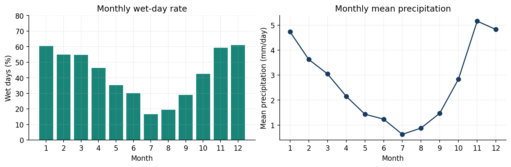
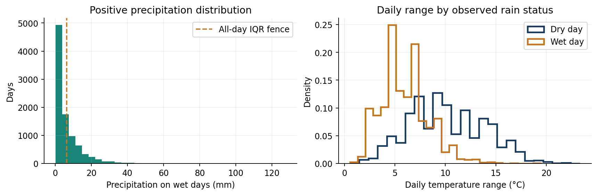
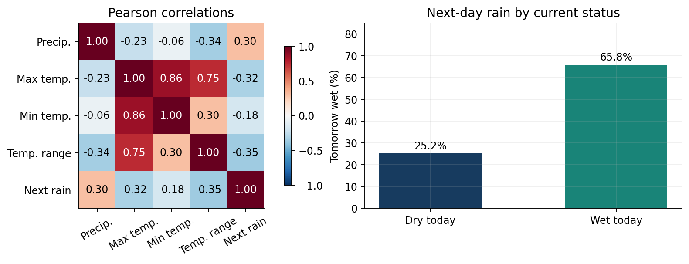
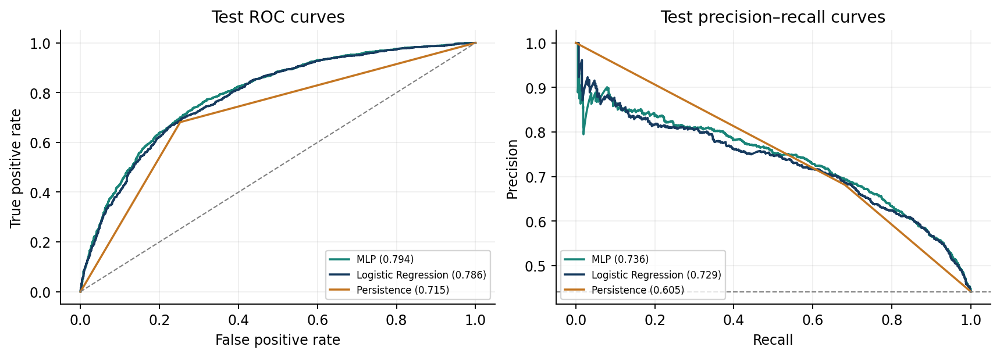
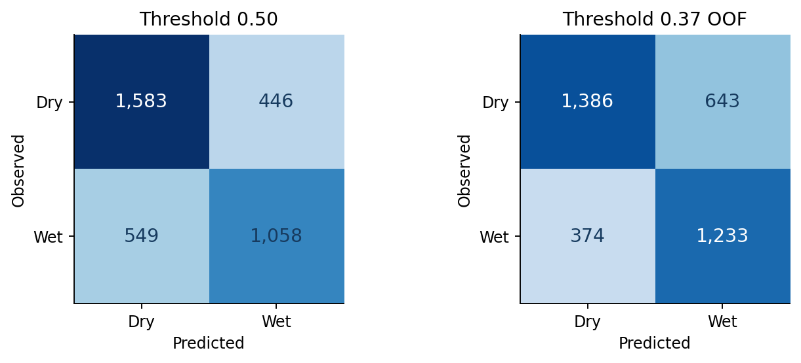
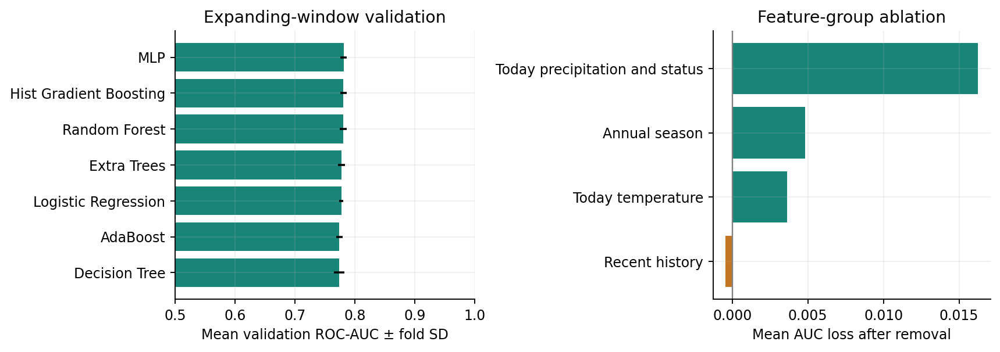

# 시애틀 일별 기상 기록을 활용한 다음 날 강수 여부 예측

| 이름 | 학과 | 학번 | 담당 역할 |
|---|---|---|---|
| 우안신 | 스포츠매니지먼트 | 2024082479 | 코드 구현 |
| 우현 | 스포츠사이언스 | 2024045350 | 데이터셋 선정 및 데이터셋 처리|
| 이위 | 스포츠매니지먼트 | 2024016653 | 보고서 작성  |
| 황문박 | 스포츠사이언스 | 2024068131 | 유튜브 영상 녹화및 그래프 분석 |

### 분석 요약

Kaggle의 시애틀 일별 관측 25,551건으로 강수 계절성을 살펴보고, 오늘 관측이 끝난 시점에 다음 날 강수 여부를 예측했다. 5개 시계열 검증 구간에서 MLP의 평균 ROC-AUC가 0.7811로 가장 높았다. 보류 테스트 3,636일의 AUC는 0.7939, 정확도는 72.6%, 재현율은 65.8%였다.

오늘의 상태를 내일에 그대로 적용한 지속성 기준선의 AUC는 0.7145였다. 선택 모델의 임계값을 0.50에서 검증으로 선택한 0.37로 바꾸면 위음성은 549건에서 374건으로, 위양성은 446건에서 643건으로 달라졌다. 이 차이를 야외 스포츠 운영에 필요한 준비와 비용의 관점에서 해석했다.

데이터셋:https://www.kaggle.com/datasets/rtatman/did-it-rain-in-seattle-19482017

유튜브 영상:https://youtu.be/gqEBw39Az_g?si=neeDF9v1oBL6kWIM
## 1 서론

### 1.1 연구 배경과 예측 시점

야외 경기와 훈련은 비가 예상될 때 대체 공간, 장비 보관, 참가자 공지를 미리 준비해야 한다. 이 연구는 단일 관측소에서 측정한 일별 기록만 가지고 다음 날 강수 여부를 어느 정도 구분할 수 있는지 확인한다. 예측은 오늘 관측이 끝난 시점에 한 번 발행하며, 운영 예시는 다음 날 일정의 준비 단계에 한정한다.

분석의 출발점은 이전 심장질환 보고서의 순서이다. 자료 품질을 확인한 뒤 탐색적 분석을 하고, 일곱 분류기를 같은 조건에서 비교한다. 날씨는 연속된 날짜 사이에 관계가 있으므로, 임의 분할 대신 시계열 분할을 사용하고 평가 구간을 과거에서 미래 순서로 유지했다.

### 1.2 연구 질문

① 훈련 기간에서 월별 강수일 비율과 평균 일강수량은 어떻게 달라지는가?

② 오늘 강수 여부에 따라 다음 날 강수일 비율은 얼마나 다른가?

③ 일곱 분류 모델 중 어떤 모델이 미래 구간에서 안정적인 성능을 보이는가?

④ 경보 임계값과 입력 변수 구성의 변화는 오류 건수와 판별력에 어떤 차이를 만드는가?

### 1.3 연구 단위와 결과의 해석

관측 단위는 하루이다. 강수 여부의 양성은 CSV에 기록된 RAIN=True로 정의한다. 유효 기록에서 이 값이 일강수량 0 초과와 일치하는지 검사했다. 같은 날 강수량으로 같은 날 레이블을 맞히면 이미 관측된 답을 사용하는 셈이므로, 목표를 하루 앞으로 옮겨 다음 날의 실제 측정값을 입력에서 제외했다.

## 2 데이터셋 소개

### 2.1 자료 출처와 기간

Rachael Tatman이 Kaggle에 공개한 Did it rain in Seattle? (1948–2017) 데이터의 CSV를 Kaggle API에서 직접 내려받았다[1]. 관측소 정보는 NOAA NCEI의 시애틀 타코마 공항 관측소 페이지를 확인했다[2]. CSV에는 1948-01-01부터 2017-12-14까지 25,551개의 날짜가 있으며, 실제 끝 날짜는 2017년 12월 14일이다.

| 필드 | 뜻 | 원본 단위와 분석 사용 방식 |
| --- | --- | --- |
| DATE | 관측일 | 날짜 정렬, 목표일 분할 및 계절 특징 |
| PRCP | 일강수량 | 인치 → mm, 오늘과 이전 관측의 입력 |
| TMAX | 일 최고기온 | °F → °C, 현재 관측 입력 |
| TMIN | 일 최저기온 | °F → °C, 현재 관측 입력 |
| RAIN | 강수 여부 | True=1, False=0. 오늘 값은 입력, 다음 날 값은 목표 |

### 2.2 품질과 클래스 구성

누락된 달력 날짜와 중복 날짜는 없었다. 전체 유효 25,548일 가운데 강수일은 10,900일(42.7%), 무강수일은 14,648일이었다. PRCP와 RAIN이 동시에 비어 있는 3일은 1998-06-02, 1998-06-03, 2005-09-05이다. 목표 결측일을 제외하되, 이전 관측일에는 해당 날짜를 그대로 남겨 달력 지연이 틀어지지 않게 했다.

1951-11-20은 TMAX=4°F, TMIN=39°F로 최고기온이 최저기온보다 낮다. 두 온도만 결측으로 바꾸고 해당 날의 강수 자료를 유지했다. 그 외 최저기온 0°F는 유효한 온도로, 강수량 0은 무강수 관측으로 보존했다.

### 2.3 시간순 분할

| 구간 | 예측 대상 날짜 | 유효 목표일 | 강수일 |
| --- | --- | --- | --- |
| 훈련 | 1948-01-02 ~ 2007-12-31 | 21,911 | 9,292 |
| 보류 테스트 | 2008-01-01 ~ 2017-12-14 | 3,636 | 1,607 |

첫 날짜에는 전날 관측이 없어 목표일이 될 수 없고, 마지막 관측일에는 그다음 날 목표가 없다. 이 차이와 목표 결측 3일 때문에 전체 원본 행 수와 모델링 행 수가 다르다.

## 3 탐색적 데이터 분석

### 3.1 기초 통계와 계절성

| 측정값 | 유효 일수 | 평균 | 표준편차 | 중앙값 | 최댓값 |
| --- | --- | --- | --- | --- | --- |
| 강수량 (mm) | 21,912 | 2.66 | 6.02 | 0.00 | 127.51 |
| 최고기온 (°C) | 21,914 | 15.20 | 7.05 | 14.44 | 37.78 |
| 최저기온 (°C) | 21,914 | 6.82 | 4.91 | 6.67 | 20.56 |
| 일교차 (°C) | 21,914 | 8.38 | 3.81 | 7.78 | 23.33 |

*그림 1. 훈련 기간의 월별 강수일 비율과 평균 일강수량*

12월의 강수일 비율이 61.1%로 가장 높고 7월은 16.7%로 가장 낮아 차이는 44.4%p였다. 월별 강수일 비율은 유효한 강수 여부를 분모로 하며, 평균 강수량은 무강수일의 0을 포함한다. 장기간의 월별 관측 패턴을 요약한 결과다.

### 3.2 강수 분포와 극단값

*그림 2. 양의 강수량 분포와 당일 강수 여부별 일교차 분포*

훈련 기간에 강수량 0인 날은 12,619일이었다. 전체 훈련 관측으로 계산한 IQR 상한은 6.35 mm이며 이를 초과한 날은 3,019일이다. 최대 일강수량은 2003-10-20의 127.51 mm였다. 강수량은 0이 많고 오른쪽 꼬리가 길어 IQR 상한 초과를 오류로 보지 않고 보존했다.

### 3.3 연속일 관계와 상관

*그림 3. 관측 변수의 상관관계와 오늘 상태별 내일 강수 비율*

| 오늘 상태 | 내일 무강수 | 내일 강수 | 내일 강수 비율 |
| --- | --- | --- | --- |
| 무강수 | 9,440 | 3,176 | 25.2% |
| 강수 | 3,177 | 6,116 | 65.8% |

오늘 강수일의 내일 강수 비율은 65.8%, 오늘 무강수일에는 25.2%였다. 두 상태의 차이는 40.6%p로 지속성 기준선을 평가할 근거가 된다. 비율 계산에는 오늘과 내일의 RAIN을 모두 아는 연속일만 사용했다.

오늘 일강수량과 내일 강수 여부의 피어슨 상관은 0.299, 오늘 일교차와 내일 강수 여부의 상관은 -0.354였다. 같은 날 최고·최저기온과 일교차는 서로 관계가 있으므로 상관을 각각의 독립적 효과로 해석하기 어렵다. 계절이나 지속되는 기상 조건이 함께 영향을 줄 수 있다.

탐색적 분석은 2007년 12월 31일까지의 관측값으로 제한했다. 날짜 간 자기상관이 있는 자료이므로 독립 표본을 가정한 유의성 검정을 그대로 옮기지 않고 관측 비율과 차이의 크기를 제시했다. 모델의 증분 기여는 같은 시계열 구간에서 변수군을 제거한 뒤 다시 학습하여 비교했다.

## 4 데이터 전처리 및 방법론

### 4.1 입력과 목표의 시간 정렬

목표 열은 다음 날 RAIN이다. 입력은 오늘의 강수량·강수 여부·최고 및 최저기온·일교차, 어제 강수량, 오늘까지 최근 3일과 7일의 강수량 합·강수일 비율, 최근 3일 평균 일교차, 달력상 내일 날짜의 연간 주기 사인과 코사인이다. 달력 정보는 미리 알 수 있으며 오늘 이후의 실제 기상 측정은 사용하지 않았다.

일강수량은 인치에 25.4를 곱했고, 기온은 (화씨−32)×5/9로 섭씨로 바꿨다. 최근 관측 창에는 해당 창의 모든 값이 있어야 통계를 계산한다. 입력 결측은 훈련 구간의 중앙값으로 채우고 같은 구간의 평균과 표준편차로 표준화했다. 두 변환과 분류 모델은 하나의 Pipeline에 연결했다.

### 4.2 확장 창 검증

| 훈련 종료 | 검증 시작 | 검증 종료 | 훈련 n | 검증 n |
| --- | --- | --- | --- | --- |
| 1982-12-31 | 1983-01-01 | 1987-12-31 | 12,783 | 1,826 |
| 1987-12-31 | 1988-01-01 | 1992-12-31 | 14,609 | 1,827 |
| 1992-12-31 | 1993-01-01 | 1997-12-31 | 16,436 | 1,826 |
| 1997-12-31 | 1998-01-01 | 2002-12-31 | 18,262 | 1,824 |
| 2002-12-31 | 2003-01-01 | 2007-12-31 | 20,086 | 1,825 |

검증 구간별 평균 ROC-AUC가 가장 큰 모델을 선택한 후, 2007년 말까지의 자료 전체로 각 모델을 한 번 다시 적합했다. 보류 테스트에서는 매일 새 관측이 들어온다는 조건으로 점수를 계산했다. 이전 검증일이나 테스트일의 실제 관측은 다음 날 예측 시점에 이미 알려진 값이므로 입력에 포함할 수 있다.

### 4.3 성능 및 운영 지표

ROC-AUC는 강수일이 무강수일보다 높은 점수를 받을 가능성을 나타낸다. AP는 정밀도·재현율 곡선을 요약한다. 기본 임계값 0.50에서는 정확도, 정밀도, 재현율, 특이도, F1과 오류 건수를 계산했다. Brier 점수는 0/1 결과와 예측 점수 사이의 제곱오차 평균이며 작을수록 좋다. 보류 양성 비율은 PR 곡선의 참고선으로 표시했다.

### 4.4 모델 구성과 비교 기준선

| 비교 모델 | 핵심 설정 | 비교 목적 |
| --- | --- | --- |
| Logistic Regression | C=1, 최대 500회 | 선형 확률 모델 기준 |
| Decision Tree | 깊이 5, 리프 최소 80건 | 단일 분할 규칙 |
| Random Forest | 트리 140개, 깊이 9, 리프 최소 20건 | 부트스트랩 트리 앙상블 |
| Extra Trees | 트리 140개, 깊이 10, 리프 최소 20건 | 무작위 분할 앙상블 |
| Hist Gradient Boosting | 반복 100회, 최대 리프 15, 학습률 0.06 | 히스토그램 기반 부스팅 |
| AdaBoost | 반복 100회, 학습률 0.5 | 가중치를 조정하는 부스팅 |
| MLP | 은닉층 24/12, alpha=0.02, 최대 210회 | 얕은 신경망 |

모든 모델에는 동일한 13개 입력을 사용하고 설정을 고정했다. 확률적 요소가 있는 모델의 난수 시드는 42로 설정했다. 전체를 무강수로 분류하는 기준선과 오늘의 강수 상태를 내일에 복사하는 지속성 기준선을 함께 사용했다. 지속성 기준선에서 오늘 RAIN이 비어 있으면 무강수로 처리하도록 정했으며, 보류 기간에는 그 대체가 필요하지 않았다.

### 4.5 임계값과 오차 구간

경기 전 준비에서 강수를 놓치는 비용이 헛준비보다 크다는 가정 아래, 위음성 1건에 비용 2, 위양성 1건에 비용 1을 부여했다. 적합 과정에서 본 적이 없는 다섯 검증 구간의 예측을 합친 뒤, 0.05부터 0.95까지 0.01 간격으로 후보를 평가했다. 비용이 같으면 0.50에 가까운 값, 거리가 같으면 낮은 값을 선택했다. 실제 비용이 조사되지 않았으므로 이 수치는 비교를 위한 가정이다.

보류 테스트 AUC 구간은 날짜 순서와 단기 의존을 일부 유지하기 위해 30일 연속 블록을 1,000회 재표집해 구했다. 순환 방식으로 끝이 시작과 이어지도록 했으며, 반복마다 목표와 점수를 함께 추출했다. 기간 밖의 기후 변화와 학습 불확실성은 이 구간에 포함되지 않는다.

## 5 실험 결과

### 5.1 검증과 모델 선택

| 모델 | 83–87 | 88–92 | 93–97 | 98–02 | 03–07 | 평균 | 표준편차 |
| --- | --- | --- | --- | --- | --- | --- | --- |
| MLP | 0.7866 | 0.7782 | 0.7865 | 0.7738 | 0.7806 | 0.7811 | 0.0055 |
| Hist Gradient Boosting | 0.7818 | 0.7785 | 0.7893 | 0.7744 | 0.7801 | 0.7808 | 0.0055 |
| Random Forest | 0.7805 | 0.7786 | 0.7897 | 0.7737 | 0.7806 | 0.7806 | 0.0058 |
| Extra Trees | 0.7808 | 0.7748 | 0.7847 | 0.7697 | 0.7784 | 0.7777 | 0.0057 |
| Logistic Regression | 0.7810 | 0.7740 | 0.7804 | 0.7734 | 0.7770 | 0.7771 | 0.0035 |
| AdaBoost | 0.7698 | 0.7703 | 0.7826 | 0.7722 | 0.7741 | 0.7738 | 0.0052 |
| Decision Tree | 0.7677 | 0.7680 | 0.7878 | 0.7690 | 0.7760 | 0.7737 | 0.0086 |

MLP의 평균 검증 AUC는 0.7811이고, 2위 Hist Gradient Boosting는 0.7808였다. 평균 차이는 0.0003이다. 폴드 표준편차는 기간별 변동의 크기를 보여준다. 이 표만으로 모델 간 유의한 차이를 결론 내릴 수는 없다.

### 5.2 보류 테스트 결과

| 모델 | AUC | AP | 정확도 | 정밀도 | 재현율 | F1 |
| --- | --- | --- | --- | --- | --- | --- |
| MLP | 0.7939 | 0.7364 | 0.7263 | 0.7035 | 0.6584 | 0.6802 |
| Hist Gradient Boosting | 0.7954 | 0.7348 | 0.7222 | 0.7057 | 0.6372 | 0.6697 |
| Random Forest | 0.7924 | 0.7282 | 0.7222 | 0.7010 | 0.6478 | 0.6734 |
| Extra Trees | 0.7900 | 0.7231 | 0.7239 | 0.6974 | 0.6627 | 0.6796 |
| Logistic Regression | 0.7863 | 0.7289 | 0.7239 | 0.7064 | 0.6422 | 0.6728 |
| AdaBoost | 0.7895 | 0.7268 | 0.7189 | 0.7085 | 0.6185 | 0.6605 |
| Decision Tree | 0.7837 | 0.7104 | 0.7225 | 0.7085 | 0.6322 | 0.6682 |
| 지속성 기준선 | 0.7145 | 0.6051 | 0.7184 | 0.6814 | 0.6814 | 0.6814 |
| 항상 무강수 | 0.5000 | 0.4420 | 0.5580 | — | 0.0000 | 0.0000 |

테스트 최고 AUC는 Hist Gradient Boosting의 0.7954였다. 최종 모델은 앞서 검증으로 선택한 MLP을 유지했다. 이 모델의 AUC 0.7939는 지속성 기준선 0.7145보다 0.0793 높았다. 정확도는 각각 72.6%와 71.8%였다. 모든 날을 무강수로 분류한 경우 정확도는 55.8%이고, 강수일을 검출하지 못해 재현율은 0이었다. 지속성 기준선의 재현율은 68.1%로 기본 임계값 MLP의 65.8%보다 높았다. 항상 무강수 기준선은 양성 예측이 없어 정밀도를 대시로 표시했다.

### 5.3 ROC와 정밀도 재현율 곡선

*그림 4. 보류 테스트의 ROC와 정밀도 재현율 곡선*

선택 모델의 AP는 0.7364이고 보류 목표의 강수 비율은 44.2%였다. Brier 점수는 0.1835로, 점수의 정확성에 대한 별도 측정값이다. AUC의 30일 블록 재표집 95% 구간은 0.7709부터 0.8146였다. 이 범위는 단일 보류 기간에 대한 불확실성으로 해석한다.

### 5.4 분류 임계값에 따른 오류

*그림 5. 기본 임계값과 검증에서 고른 임계값의 혼동 행렬*

| 기준 | 위음성 | 위양성 | 재현율 | 특이도 | 가정 비용 |
| --- | --- | --- | --- | --- | --- |
| 0.50 | 549 | 446 | 65.8% | 78.0% | 1,544 |
| 0.37 OOF | 374 | 643 | 76.7% | 68.3% | 1,391 |

검증에서 선택한 0.37를 테스트에 한 번 적용했다. 기본 대비 위음성은 175건 줄었고 위양성은 197건 늘었다. 가정 비용은 1,544에서 1,391로 변했다. 이 비교는 이상적인 임계값을 확정하기보다 다른 준비 비용을 가정할 때 결정이 어떻게 달라지는지 보여준다.

### 5.5 특징 공학과 변수군의 기여

*그림 6. 시계열 검증의 평균 AUC와 변수군 제거 전후의 차이*

| 로지스틱 회귀 입력 | 평균 검증 AUC | 직전 단계 대비 |
| --- | --- | --- |
| 달력만 | 0.6735 | — |
| 달력과 오늘 관측 | 0.7766 | +0.1031 |
| 달력과 오늘 관측 및 최근 이력 | 0.7771 | +0.0006 |

연간 달력만 사용한 로지스틱 회귀는 평균 AUC가 0.6735였다. 오늘의 측정값을 추가하면 0.7766, 최근 이력까지 추가하면 0.7771였다. 선택 모델의 변수군 제거 실험에서 오늘 강수량 및 강수 여부을 뺐을 때 AUC 변화가 가장 컸고, 전체 입력과 제거 모델의 차이는 0.0163였다. 최근 이력을 빼면 MLP의 평균 AUC는 약 0.0004 높아졌다. 상관된 입력이 정보를 대신할 수 있으며, 이런 작은 차이로 입력의 독립적인 원인 효과를 판단할 수 없다.

### 5.6 계절별 보류 성능

| 계절 | 일수 | 강수율 | AUC | 재현율 | 위양성 |
| --- | --- | --- | --- | --- | --- |
| 겨울 | 886 | 58.5% | 0.7475 | 78.2% | 146 |
| 봄 | 920 | 51.5% | 0.7329 | 63.5% | 140 |
| 여름 | 920 | 18.8% | 0.7420 | 27.2% | 32 |
| 가을 | 910 | 48.6% | 0.7739 | 69.0% | 128 |

기본 임계값에서 여름 강수율은 18.8%이고 겨울은 58.5%이다. 재현율은 각각 27.2%, 78.2%였다. 전체 연도의 평균 성능이 좋더라도 여름철처럼 강수 자체가 적은 구간에서 같은 비율로 강수를 검출하지는 못한다.

## 6 토론

### 6.1 분석 결과의 의미

월별 차이와 연속일 강수 패턴을 함께 고려하면, 계절과 바로 전날의 관측을 활용하는 간단한 접근에도 정보가 있다. AUC에서 단순 기준선을 넘었다는 결과는 이번 보류 기간 안에서 강수일에 더 높은 점수를 부여했다는 뜻이다. 특정 경기장의 시간대별 강수 확률이나 일정 변경 효과는 이 자료에서 직접 평가할 수 없다.

### 6.2 야외 스포츠 일정의 준비 순서

학교 대회 운영을 예로 들면, 하루 전 강수 점수가 예비 기준을 넘을 때 대체 시설의 예약 가능 여부를 확인하고 참가자 공지 초안을 준비할 수 있다. 이런 준비의 실제 비용과 강수 대응을 놓쳤을 때의 손실을 기록하면, 보고서의 2 대 1 가정을 현장 수치로 바꿔 비교할 수 있다. 경기 당일 출전이나 취소를 결정하려면 경기장 위치와 시간대의 공식 예보, 지면 상태 및 대회 안전 지침을 함께 확인해야 한다.

### 6.3 한계와 후속 분석

첫째, 대상은 시애틀 공항의 단일 지점이며 테스트도 2017년에 끝난다. 현재의 기후나 한국의 운동장으로 일반화하려면 해당 지역의 최근 자료와 새로운 보류 구간이 필요하다. 둘째, 일별 강수 표지는 강수 시각, 강도, 유형과 관측 지점의 공간 대표성을 분리하지 못한다.

셋째, 관측 자료에는 레이더, 기압, 습도, 풍속과 공식 수치예보가 없다. 실무에 가까운 비교에는 같은 목표 시간대의 공식 예보를 기준선으로 추가하고 예측 확률의 보정을 별도로 평가할 수 있다. 넷째, 고정된 특징과 모델 설정으로 비교한 결과이므로 모델 순위는 입력 범위와 검증 기간을 바꾸면 달라질 수 있다.

## 7 결론

시애틀의 다음 날 강수 여부를 예측하는 문제에서 MLP의 평균 시계열 검증 AUC는 0.7811, 보류 테스트 AUC는 0.7939였다. 기준선 비교로 최근 관측이 제공하는 분류 정보를 확인했고, 임계값 조정으로 강수 누락과 헛경보 사이의 교환 관계를 수치화했다. 스포츠 운영의 준비 단계에 적용하려면 먼저 지역과 시간 단위를 맞춘 외부 검증이 필요하다.

## 참고문헌

### 참고문헌

[1] Rachael Tatman. Did it rain in Seattle? (1948–2017). Kaggle. 원본 CSV 다운로드에 사용.
<https://www.kaggle.com/datasets/rtatman/did-it-rain-in-seattle-19482017>

[2] NOAA National Centers for Environmental Information. Daily Summaries Station Details, Seattle Tacoma Airport (USW00024233).
<https://www.ncei.noaa.gov/cdo-web/datasets/GHCND/stations/GHCND:USW00024233/detail>

[3] Pomona College. StockVsRain assignment, rainSeattle data description. PRCP, TMAX, TMIN의 원본 단위 확인.
<https://cs.pomona.edu/classes/cs51p/archive/sp2020/assignments/A9/StockVsRain.html>

